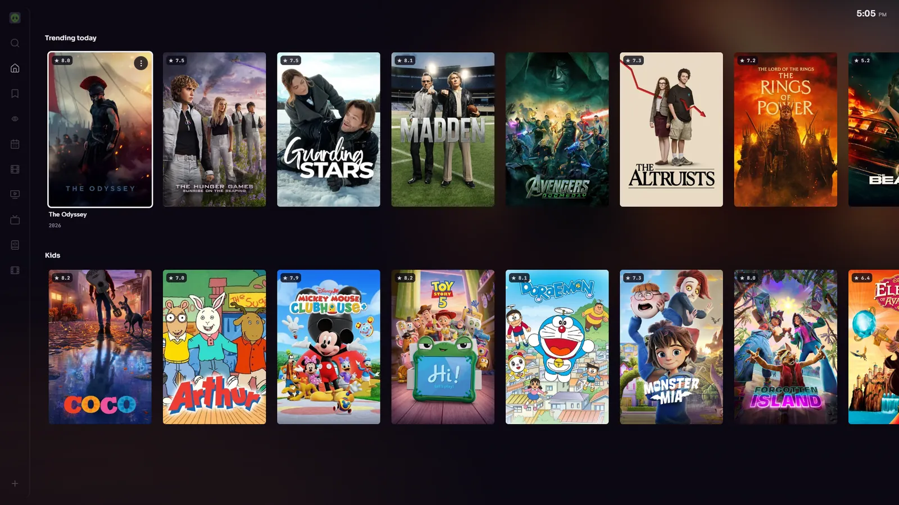
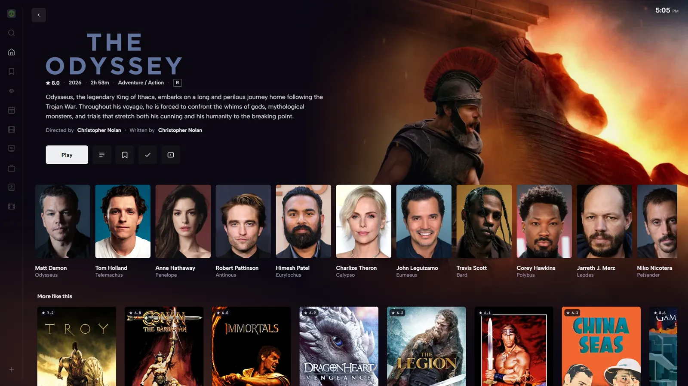
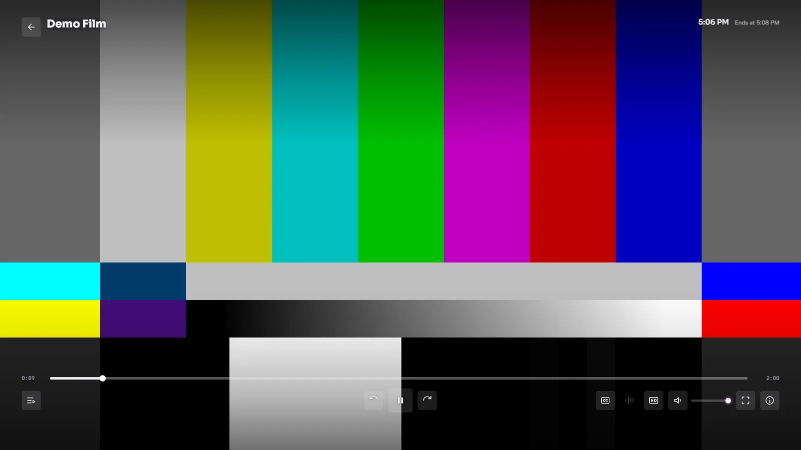
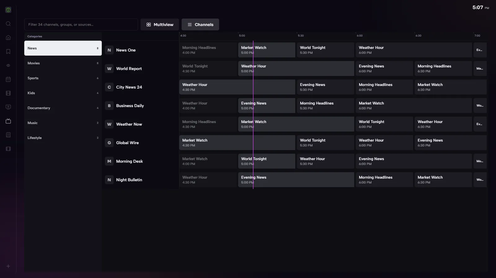
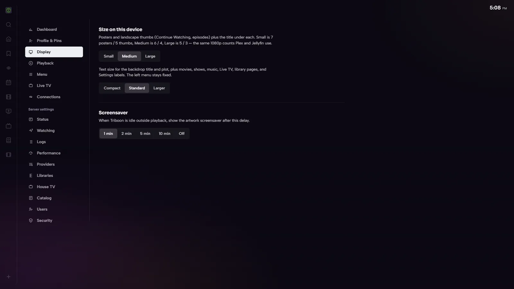
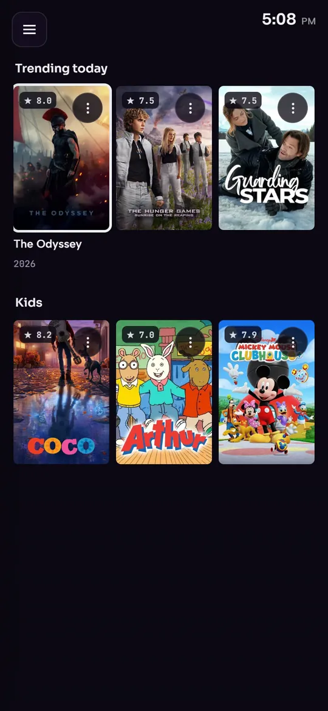

<p align="center">
  <picture>
    <source media="(prefers-color-scheme: dark)" srcset="logo/triboon.svg">
    
  </picture>
</p>

<p align="center">
  <strong>Press Play.</strong> Triboon finds a healthy source, mounts it, and starts streaming.<br>
  Self-hosted movies, shows, your own library, Live TV, music, subtitles, and Trakt.
</p>

<p align="center">
  <a href="https://github.com/d1same/triboon/releases/latest"></a>
  <a href="LICENSE"></a>
  <a href="https://github.com/d1same/triboon/pkgs/container/triboon"></a>
  <a href="https://github.com/d1same/triboon/releases/latest/download/triboon.apk"></a>
</p>

<p align="center">
  <a href="#unraid">Unraid</a>
  ·
  <a href="#docker">Docker</a>
  ·
  <a href="#windows">Windows</a>
  ·
  <a href="#android">Android</a>
  ·
  <a href="#first-run">First run</a>
  ·
  <a href="docs-setup.md">Setup guide</a>
</p>

## What is Triboon?

Triboon is a streaming app you run on your own server. It looks and feels like
Plex, and it finds sources like Stremio.

You, the admin, add your accounts once: a usenet provider, an indexer, a free
TMDB key, and optionally Live TV playlists, subtitles, and Trakt. Your family
and friends just sign in, pick a profile, and press Play. They never see a key
or a password.

When someone presses Play, Triboon searches your indexers, picks the best
healthy copy, and starts streaming it while it is still on usenet. If that copy
turns out to be broken, it moves to the next one and resumes at the same
second. Films you already own on disk play directly.

**Your keys stay on your server.** Every key and password goes into Settings
and is stored encrypted in your `/data` folder. None of it is in this repo or in
the public Docker image.

## Screenshots

The Quiet Graphite look (3.5) on a 1920x1080 screen, from a demo server with a
made-up account, test video, and made-up Live TV channels. Posters and cast
photos come from TMDB.

| Home | Title page |
|---|---|
|  |  |
| **Player** | **Live TV guide** |
|  |  |
| **Settings** | **Phone** |
|  |  |

## Features

**Watching**

- Movies and TV with TMDB posters, logo art, cast, seasons, a watchlist, and a
  calendar.
- Fast start. Opening a title can warm up its source, so Play reuses it instead
  of starting from zero. Playback tries direct play first, then remux, then
  transcode.
- Health protection & **TRaSH press-play scoring**. Triboon checks a source
  quickly before it starts and keeps checking in the background. Built-in TRaSH
  rules filter out CAM, 3D split-screen, hardcoded subs, and low-quality
  re-encoders — all individually toggleable with 1-by-1 editable Trusted/Avoid
  groups under **Settings → Catalog → Scoring**. A broken copy is swapped for
  the next healthy one at the same timestamp.
- Continue Watching and **Up next**. Progress follows the file on disk, so a
  renamed folder or a new episode does not move your progress onto another
  title. Up next works for shows in your own library too.
- Pause as long as you like. A long pause on a local file resumes where you
  left off.
- Sensible audio. Triboon never picks an Audio Description copy or soundtrack
  (the narrator track for blind viewers) when a normal one exists. If you
  choose one yourself, your choice wins.
- Subtitles from Wyzie or OpenSubtitles, with automatic timing fixes when the
  server has `alass`.

**Your own media**

- Local libraries for films and shows you own. Titles follow the folder name,
  and the library check waits while someone is watching.
- If usenet finds nothing, or you own the film in 4K, Play uses your file.

**Live TV**

- Bring your own M3U or Xtream playlists, each with its own guide.
- A full TV guide, favourites, Multiview, and direct channel surfing
  (`Ch-` / `Ch+`) across Web, Android TV, Fire TV, Windows, Apple TV, and Roku.
- **Max connections** per playlist (Settings → House TV → edit the playlist).
  When a new stream would go over your provider's limit, Triboon stops the
  oldest stream on that playlist and tells that screen why, instead of the
  provider cutting streams at random. Leave it empty for no limit.

**People and apps**

- Accounts with profiles, PINs, invites, and per-user quality caps.
- Sign in on a TV by scanning a QR code with your phone (Quick Connect).
- Trakt sync, Music, and Audiobooks.
- Optional Jellyfin app support: the official Jellyfin apps can sign in and
  play from your Triboon server (Settings → Libraries → Jellyfin apps, off by
  default).

**Look**

- **Quiet Graphite** is the default look since 3.5: near-black buttons, a white
  focus ring, crisp corners, and a magenta Play button, on every screen.
- A new Triboon logo since 3.4.16.
- Built for the remote: every screen works with a TV remote's arrow keys.

**Apps**

- **Web** in any modern browser at `http://<server>:7777`.
- **Android TV, Fire TV, and Android phones**: one universal APK. TV playback
  uses native Media3/ExoPlayer for 4K, HDR, surround sound, and Live TV surfing.
- **Windows**: a native player app built on libmpv with hardware decoding, plus
  a separate one-click server installer.
- **Apple iOS / tvOS, Roku, and LG webOS**: dedicated native/TV clients plus
  optional Jellyfin app compatibility (Swiftfin, Infuse, Roku, Samsung, LG).

## Install

Pick one way to host the server. Then open it in a browser and follow
[First run](#first-run).

### Unraid

1. In the Docker tab, add a container from the
   [Unraid template](unraid/triboon.xml)
   ([raw URL](https://raw.githubusercontent.com/d1same/triboon/main/unraid/triboon.xml)).
2. Image: `ghcr.io/d1same/triboon:latest`.
3. Map `/data` to `/mnt/user/appdata/triboon`.
4. Optional: map a media share to `/media` as read-only for your own library.
5. Start it and open `http://<unraid-ip>:7777`.

Useful settings:

- `PUID`, `PGID`, and `UMASK` for your Unraid user and group.
- `TRIBOON_SECRET` is optional. If you leave it empty, Triboon makes one the
  first time and keeps it in `/data/secret.json`. If you set it, never change
  it: a new secret makes your saved keys unreadable and signs everyone out.
- `TRIBOON_WYZIE_KEY` can hold the Wyzie subtitle key instead of Settings.

The segment cache is off until you turn it on under Settings → Performance.
When it is on, Triboon keeps the start, the end, and where you stopped of each
film in the same `/data` folder, up to the size you set (10 GB to start). The
oldest pieces are removed when it is full.

### Docker

The public image supports `linux/amd64` and `linux/arm64`:

```bash
docker run -d --name triboon --restart unless-stopped -p 7777:7777 -v triboon-data:/data ghcr.io/d1same/triboon:latest
```

Then open `http://localhost:7777`. Keep the named volume: `/data` holds the
server secret and everything Triboon saves. Versioned image tags are on the
[public container package](https://github.com/d1same/triboon/pkgs/container/triboon).

To build the current checkout instead: `docker compose up --build`.

### Windows

**Server** (host Triboon on a Windows PC):

```text
https://github.com/d1same/triboon/releases/latest/download/Triboon-Windows-Server.exe
```

The installer includes Node 24, ffmpeg, yt-dlp, and alass. It runs Triboon as
a Windows service that starts with the PC and opens the firewall for your home
network only. When it finishes, open `http://localhost:7777`. Other devices use
`http://<pc-name-or-ip>:7777`.

Your data lives in `C:\ProgramData\Triboon\data`. Updates and uninstalls keep
it; updates only replace the program files.

**Client** (watch on a Windows 10/11 PC):

```text
https://github.com/d1same/triboon/releases/latest/download/Triboon-Windows-Client.exe
```

It connects to your Triboon server and plays with libmpv, using the graphics
card (NVIDIA, AMD, or Intel) when it can and the CPU when it cannot.

Both installers are not code-signed yet, so Windows SmartScreen warns on first
run. Choose **More info → Run anyway**. Each release also keeps versioned
copies (`Triboon-Windows-Server-vX.Y.Z.exe`, `Triboon-Windows-Client-vX.Y.Z.exe`).

### Android

One APK for Android TV, phones, and tablets. The newest one is always here:

```text
https://github.com/d1same/triboon/releases/latest/download/triboon.apk
```

Install it, enter your server address, and sign in. On a TV you can sign in by
scanning the QR code with your phone. When a new release is out, the app
offers the update itself. Each release also keeps `triboon-vX.Y.Z.apk`; see
[`docs-app-updates.md`](docs-app-updates.md) for how updates work.

### Plain Node

With Node 24 or newer installed:

```bash
node server/index.js
```

Install ffmpeg too. Without it, some browsers and devices cannot play files
that need a remux or transcode.

## First run

Do this right after the server starts, from a device on your home network:

1. Open `http://<server>:7777` and create the owner (admin) account.
2. Follow the built-in 3-step **Host Setup** wizard to add and live-test your
   free [TMDB](docs-setup.md) v3 key, **usenet provider**, and **Newznab /
   Prowlarr indexer** (or jump straight to local media folders). You can re-open
   this checklist anytime from **Settings → Status**.
3. Optional: add your own media under **Libraries**, Live TV playlists under
   **House TV**, a Wyzie or OpenSubtitles key, Trakt, or Music, and customize
   TRaSH scoring rules under **Settings → Catalog → Scoring**.
4. Invite your family under **Users**, then go to Home and press Play.

New to these services? The [Setup guide](docs-setup.md) explains each key step
by step, with links and which ones are free.

**Safe remote access.** The owner-setup page is open only until the first
account exists, so never expose port 7777 to the internet before you create it.
Triboon itself serves plain HTTP. Finish setup on your trusted LAN first, then
reach it from outside through a VPN or an HTTPS reverse proxy. Set
`TRIBOON_TRUST_PROXY=1` only when that proxy removes client-supplied forwarding
headers.

## Security and privacy

- Provider and indexer keys, IPTV logins, Trakt tokens, subtitle keys, and
  YouTube Music cookie sessions are encrypted (AES-256-GCM) in `/data`.
  Account names, password hashes, watch history, and library data are stored
  there too but not encrypted, so protect `/data` and its backups.
- The public image contains only the app: no one's `/data`, keys, signing
  keys, or local files.
- Every API route is deny-by-default and covered by route tests. Stream links
  use signed, scoped tokens.
- Playlist and provider URLs with logins are hidden in logs and caches.
- Viewer city/country lookup is off by default. If you turn it on, a remote
  viewer's public IP is sent to `ipwho.is`; raw IPs are not saved in history or
  shown to users.
- Android backups and device transfers leave out the saved server login and
  Live TV logins; sign in again after a restore.

Report security problems privately as described in [`SECURITY.md`](SECURITY.md),
never in a public issue. Never commit your `data/` folder, `.env` files, keys,
cookies, logs, or personal screenshots.

## Development

The server runs on Node 24 LTS with no runtime npm packages. It uses a few
approved external tools: ffmpeg, yt-dlp, and alass (the Docker image also
includes `ytmusicapi` for Music search).

```bash
npm start          # run the server
npm test           # the Node test suites
```

Before pushing a change, run the full gate in [`VERIFY.md`](VERIFY.md)
(`npm.cmd run verify:full` on Windows). It covers Live TV, fast start,
captions, the web player, and the Android player.

Android lint, unit tests, and a debug APK (Gradle 9.5.1 or newer):

```powershell
$env:JAVA_HOME='C:\Program Files\Android\Android Studio\jbr'
$env:ANDROID_HOME="$env:LOCALAPPDATA\Android\Sdk"
gradle -p android lintDebug testDebugUnitTest assembleDebug
```

Output: `android/app/build/outputs/apk/debug/app-debug.apk`.

Repo map: `server/` API and streaming, `web/index.html` the whole UI,
`android/` the Android TV and phone app, `clients/windows-px8/` the Windows
client, `installer/windows/` the Windows server installer, `unraid/` the
Unraid template.

## Docs

- [`docs-setup.md`](docs-setup.md): getting each key and account
- [`docs-architecture.md`](docs-architecture.md): how Triboon works inside
- [`docs-streaming-performance.md`](docs-streaming-performance.md): connections and buffering
- [`docs-playback-and-iptv.md`](docs-playback-and-iptv.md): playback and Live TV
- [`docs-continue-watching.md`](docs-continue-watching.md): resume and Up next
- [`docs-app-updates.md`](docs-app-updates.md): Android, Windows, and Docker updates
- [`docs-player-regression-map.md`](docs-player-regression-map.md): player contracts
- [`VERIFY.md`](VERIFY.md): the check every release must pass

## Legal

Triboon's source is under the [MIT License](LICENSE). Bundled external tools
keep their own licenses; see [Third-Party Notices](THIRD-PARTY-NOTICES.md).

Triboon is for legally obtained content only. You are responsible for the
providers, playlists, indexers, files, and accounts you configure.
